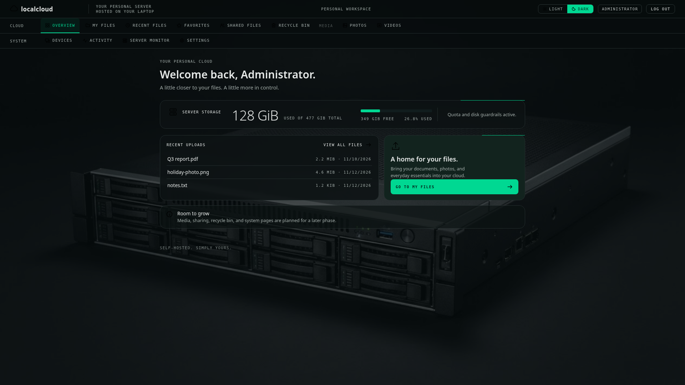
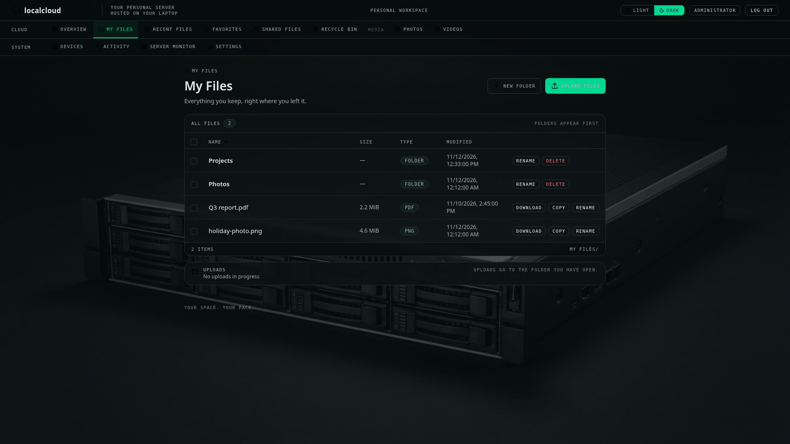

# MyCloud

Self-hosted personal cloud storage and device management. Your source code, your
storage engine, your database, your server. Python 3.14 / FastAPI / SQLAlchemy 2 /
SQLite (WAL) backend, Rust (Yew/WASM) frontend, Argon2id auth,
content-addressed deduplicating storage with versioning and soft deletion.

## Screenshots

| Overview (dark) | My Files (dark) |
|---|---|
|  |  |

More captures (login screen, light theme) live in [`docs/screenshots/`](docs/screenshots/).

## Quickstart (development)
```bash
cd ~/mycloud
python3 scripts/generate_secret.py          # paste MYCLOUD_SECRET_KEY into .env
cp .env.example .env
python3 -m venv backend/.venv               # dependency plan approved first
backend/.venv/bin/pip install -r backend/requirements.txt
cd backend && .venv/bin/uvicorn app.main:app --host 127.0.0.1 --port 8000
# second terminal:
python3 ../scripts/enroll_admin.py 8000     # interactive; prompts (no shell history)
# http://127.0.0.1:8000/api/health
```

## Frontend (Rust / Yew / WASM)
The web frontend is a Rust crate in `frontend-rs/` — cargo replaces npm entirely.
```bash
cd ~/mycloud/frontend-rs
trunk serve             # dev server, proxies /api -> 127.0.0.1:8000
trunk build --release   # static site in frontend-rs/dist/
```
Design CSS and Figma assets ship verbatim from `frontend-rs/public/` (same
files as the original design pass). Requires `trunk` and the
`wasm32-unknown-unknown` target (`rustup target add wasm32-unknown-unknown`).

The original React + Vite app is kept in `frontend/` for reference; it is
superseded by `frontend-rs/` and no longer part of the build.

## Status — phases
| # | Phase | State |
|---|---|---|
| 1 | Foundation: env report, scaffold, docs | **done** |
| 2 | Database models + auth (Argon2id, sessions, CSRF) | **done** |
| 3 | Storage engine (chunked resumable uploads, blobs) | **done** |
| 4 | File manager frontend (Rust/Yew) + Figma screens | **done** |
| 5 | Folders & batch operations (hierarchy, batch APIs, DnD) | **done** |
| 6 | Recycle bin UI + version history | **recycle bin done** (version history + retention pending) |
| 7 | Photo/video system (albums, thumbnails, streaming) | pending |
| 8 | Duplicate detection | pending |
| 9 | Sharing | pending |
| 10 | Devices + sync | pending |
| 11 | Android backup client path | pending |
| 12 | Storage analytics + monitoring | pending |
| 13 | Administration + activity | pending |
| 14 | Optional E2E encryption | pending |
| 15 | Backup/recovery jobs | pending |
| 16 | Security test suite | pending |
| 17 | Remote connectivity (Tailscale) + production deployment | pending |

Docs: `ARCHITECTURE.md` · `DATABASE.md` · `API.md` · `SECURITY.md` ·
`DEPLOYMENT.md` · `BACKUP_AND_RESTORE.md` · `CHANGELOG.md` · `docs/`.
